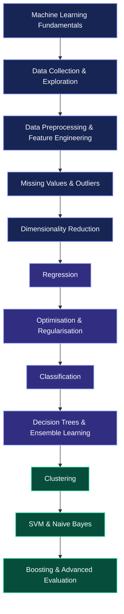
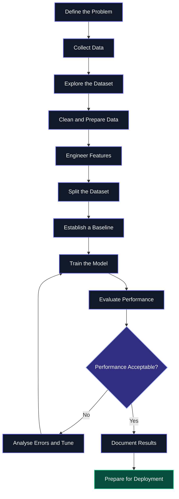
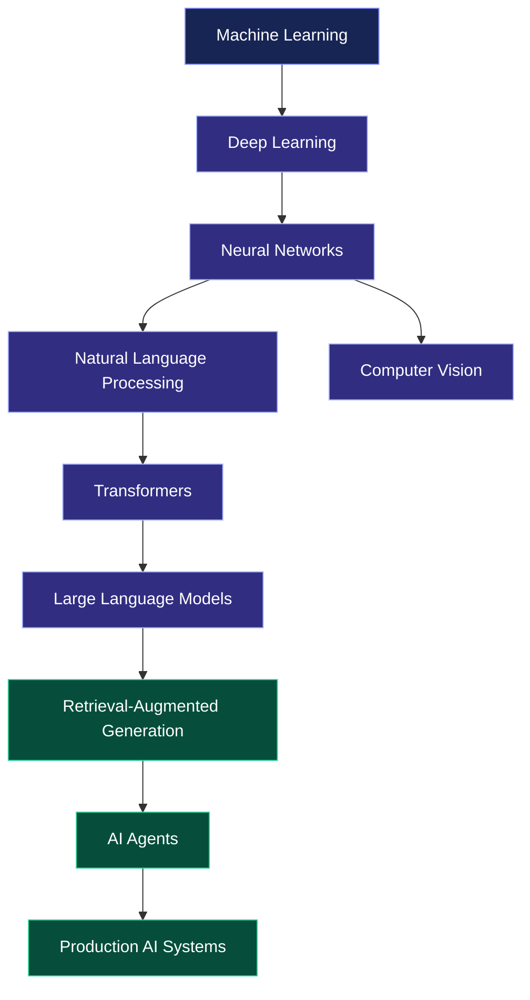

 

 

  

### ✦ Every algorithm has a story. Every dataset has a pattern. ✦

**Exploring the mathematics, logic, and engineering behind Machine Learning.**

 

[Overview](#-overview) · [Curriculum](#-complete-curriculum) · [Algorithms](#-algorithm-universe) · [Mathematics](#-mathematical-foundations) · [Workflow](#-end-to-end-machine-learning-workflow) · [Future](#-beyond-machine-learning)

---

# ◈ Overview

Machine Learning is where mathematics meets data, algorithms meet experimentation, and patterns become predictions.

This repository represents my personal journey through **Machine Learning**, following a structured progression from fundamental concepts to regression, classification, clustering, ensemble learning, and advanced model evaluation.

My focus is on understanding how Machine Learning algorithms work, why they make particular predictions, how their parameters are learned, and how their performance can be evaluated.

Rather than viewing algorithms as isolated concepts, I approach Machine Learning as an interconnected discipline involving:

* **Data:** Understanding, collecting, cleaning, and exploring datasets.
* **Mathematics:** Learning the statistical and mathematical principles behind algorithms.
* **Feature Engineering:** Transforming raw data into meaningful representations.
* **Algorithms:** Understanding how models learn patterns and make predictions.
* **Optimisation:** Improving model parameters and controlling complexity.
* **Evaluation:** Measuring performance and analysing prediction errors.
* **Engineering:** Developing a foundation for building practical intelligent systems.

> *The objective is not simply to understand what an algorithm does, but to understand why it works, when it works, and where it can fail.*

---

# ✨ Learning Dashboard

| Dimension             | Overview                                  |
| :-------------------- | :---------------------------------------- |
| Learning Domain       | Machine Learning                          |
| Learning Resource     | CampusX — 100 Days of Machine Learning    |
| Curriculum            | 134 video lessons                         |
| Core Focus            | Data Preparation, Algorithms, Mathematics |
| Regression            | Linear, Multiple Linear, Polynomial       |
| Classification        | Logistic Regression, SVM, Naive Bayes     |
| Ensemble Learning     | Voting, Bagging, Random Forest, Boosting  |
| Unsupervised Learning | K-Means, Hierarchical Clustering, DBSCAN  |
| Advanced Topics       | XGBoost, Optuna, SMOTE, ROC-AUC           |
| Long-Term Direction   | AI Engineering                            |

 

 

**134 LESSONS · A COMPLETE MACHINE LEARNING CURRICULUM**

---

# 🗺️ The Machine Learning Landscape

---

# 📚 Complete Curriculum

<strong>01 · Machine Learning Fundamentals</strong> — Videos 1–14

### Understanding Machine Learning

* What is Machine Learning?
* Artificial Intelligence vs Machine Learning vs Deep Learning
* Types of Machine Learning
* Batch Learning and Offline Learning
* Online Learning and Offline Learning
* Instance-Based Learning vs Model-Based Learning
* Challenges in Machine Learning
* Real-World Applications of Machine Learning
* Machine Learning Development Life Cycle
* Data Engineer vs Data Analyst vs Data Scientist vs ML Engineer
* Tensors and Their Role in Machine Learning
* Anaconda, Jupyter Notebook, and Google Colab
* End-to-End Toy Project
* Framing a Machine Learning Problem
* Planning a Data Science Project

### Core Understanding

Machine Learning begins with defining a problem, understanding the available data, choosing an appropriate learning approach, and establishing a systematic process for developing predictive models.

<strong>02 · Data Collection & Exploratory Data Analysis</strong> — Videos 15–22

### Data Acquisition

* Working with CSV Files
* Working with JSON Data
* Working with SQL Data
* Fetching Data from APIs
* Fetching Data Using Web Scraping

### Exploratory Data Analysis

* Understanding Your Dataset
* Univariate Analysis
* Bivariate Analysis
* Multivariate Analysis
* Pandas Profiling

### Core Understanding

Exploratory Data Analysis helps uncover data distributions, relationships, anomalies, and quality issues before the modelling process begins.

<strong>03 · Feature Engineering & Data Transformation</strong> — Videos 23–34

### Feature Scaling

* Feature Engineering Fundamentals
* Standardisation
* Normalisation
* MinMaxScaler
* MaxAbsScaler
* RobustScaler

### Categorical Data Encoding

* Ordinal Encoding
* Label Encoding
* One-Hot Encoding
* Handling Categorical Variables
* ColumnTransformer in Scikit-learn

### Machine Learning Pipelines

* Building Machine Learning Pipelines
* Reusable Preprocessing Workflows
* Consistent Data Transformation

### Mathematical Transformations

* Log Transformation
* Reciprocal Transformation
* Square-Root Transformation
* Power Transformation
* Box–Cox Transformation
* Yeo–Johnson Transformation

### Additional Feature Engineering

* Binning and Binarisation
* Discretisation
* Quantile Binning
* K-Means Binning
* Handling Mixed Variables
* Handling Date and Time Variables

### Core Understanding

Feature engineering transforms raw data into meaningful model inputs. Scaling, encoding, and transformation techniques can influence how algorithms interpret features and learn relationships.

<strong>04 · Missing Data & Outlier Treatment</strong> — Videos 35–45

### Missing-Value Handling

* Complete-Case Analysis
* Numerical Imputation Using SimpleImputer
* Categorical Imputation
* Most-Frequent Imputation
* Missing-Category Imputation
* Missing Indicators
* Random-Sample Imputation
* KNN Imputation
* Multivariate Imputation
* Multiple Imputation by Chained Equations (MICE)
* Iterative Imputer

### Outlier Detection

* Understanding Outliers
* Z-Score Method
* Interquartile Range Method
* Percentile-Based Detection
* Winsorisation

### Feature Construction

* Feature Construction
* Feature Splitting

### Core Understanding

Missing observations and outliers can affect model performance. Their treatment requires an understanding of data quality, distribution, context, and the assumptions behind each preprocessing technique.

<strong>05 · Dimensionality Reduction & PCA</strong> — Videos 46–49

### Principal Component Analysis

* Curse of Dimensionality
* Introduction to PCA
* Geometric Intuition Behind PCA
* PCA Problem Formulation
* Step-by-Step PCA Mathematics
* PCA Implementation
* PCA Visualisation

### Core Understanding

Principal Component Analysis reduces the dimensionality of a dataset by constructing new directions that capture as much variance as possible, subject to the method's mathematical constraints.

<strong>06 · Regression Algorithms</strong> — Videos 50–60

### Linear Regression

* Simple Linear Regression
* Geometric Intuition
* Mathematical Formulation
* Implementation from Scratch
* Multiple Linear Regression
* Multiple Linear Regression Mathematics
* Multiple Linear Regression Implementation

### Regression Metrics

* Mean Squared Error (MSE)
* Mean Absolute Error (MAE)
* Root Mean Squared Error (RMSE)
* R² Score
* Adjusted R² Score

### Gradient-Based Optimisation

* Gradient Descent from Scratch
* Batch Gradient Descent
* Stochastic Gradient Descent
* Mini-Batch Gradient Descent

### Non-Linear Regression

* Polynomial Regression

### Core Understanding

Regression models estimate continuous values. Their behaviour depends on the relationship represented by the model, the objective function, the optimisation procedure, and the evaluation metric.

<strong>07 · Generalisation & Regularisation</strong> — Videos 61–69

### Generalisation

* Bias-Variance Trade-Off
* Overfitting
* Underfitting

### Ridge Regression

* Geometric Intuition
* Mathematical Formulation
* Implementation from Scratch
* Gradient Descent
* Key Practical Considerations

### Lasso Regression

* Lasso Regression Intuition
* Lasso Implementation
* Why Lasso Can Create Sparse Solutions

### ElasticNet Regression

* ElasticNet Intuition
* ElasticNet Implementation

### Logistic Regression Introduction

* Introduction to Logistic Regression
* Perceptron Trick

### Core Understanding

Regularisation introduces constraints or penalties that influence model complexity. Understanding the bias-variance trade-off helps explain why a model that fits training data extremely well may still perform poorly on unseen observations.

<strong>08 · Logistic Regression & Classification Metrics</strong> — Videos 70–79

### Logistic Regression Foundations

* Perceptron Trick Implementation
* Sigmoid Function
* Loss Function
* Maximum Likelihood Estimation
* Binary Cross-Entropy
* Derivative of the Sigmoid Function
* Gradient Descent for Logistic Regression
* Logistic Regression from Scratch

### Classification Evaluation

* Accuracy
* Confusion Matrix
* Type I Errors
* Type II Errors
* Precision
* Recall
* F1 Score

### Advanced Logistic Regression

* Softmax Regression
* Multinomial Logistic Regression
* Polynomial Features in Logistic Regression
* Non-Linear Logistic Regression
* Logistic Regression Hyperparameters

### Core Understanding

Logistic Regression estimates class probabilities through a mathematical transformation of model outputs. Classification metrics help assess how effectively predictions distinguish between classes and how different types of errors affect the result.

<strong>09 · Decision Trees & Ensemble Learning</strong> — Videos 80–102

### Decision Trees

* Geometric Intuition
* Entropy
* Gini Impurity
* Information Gain
* Decision Tree Hyperparameters
* Overfitting and Underfitting in Decision Trees
* Regression Trees
* Decision Tree Visualisation Using dtreeviz

### Ensemble Learning

* Introduction to Ensemble Techniques
* Voting Ensembles
* Hard Voting vs Soft Voting
* Voting Classifiers
* Voting Regressors

### Bagging

* Introduction to Bagging
* Bagging Classifiers
* Bagging Regressors

### Random Forest

* Introduction to Random Forest
* Random Forest Intuition
* Bias-Variance Trade-Off in Random Forest
* Bagging vs Random Forest
* Random Forest Hyperparameters
* GridSearchCV
* RandomizedSearchCV
* Out-of-Bag Evaluation
* Feature Importance

### AdaBoost

* AdaBoost Classifier
* Geometric Intuition
* Step-by-Step Algorithm
* AdaBoost Implementation
* AdaBoost Hyperparameters
* GridSearchCV for AdaBoost

### Ensemble Comparisons

* Bagging vs Boosting

### Core Understanding

Decision Trees learn rules that partition the feature space. Ensemble methods combine multiple learners through voting, sampling, or sequential learning to improve predictive performance or stability.

<strong>10 · Clustering, Gradient Boosting & KNN</strong> — Videos 103–112

### K-Means Clustering

* Geometric Intuition
* K-Means Implementation in Python
* Student Clustering Example
* K-Means from Scratch

### Gradient Boosting

* Introduction to Gradient Boosting
* Mathematics of Gradient Boosting
* Gradient Boosting for Regression
* Gradient Boosting for Classification

### Ensemble Combination Strategies

* Stacking
* Blending

### Hierarchical Clustering

* Agglomerative Hierarchical Clustering
* Python Implementation

### Distance-Based Learning

* K-Nearest Neighbours (KNN)

### Regression Assumptions

* Main Assumptions of Linear Regression

### Core Understanding

Clustering identifies structure in unlabeled data, KNN relies on neighbourhood relationships, and boosting builds ensembles sequentially to improve predictions.

<strong>11 · Support Vector Machines & Naive Bayes</strong> — Videos 113–126

### Support Vector Machines

* Geometric Intuition
* Hard-Margin SVM
* Soft-Margin SVM
* Mathematical Formulation
* Kernel Trick
* Kernel Trick Implementation
* Geometric Intuition Behind Kernels

### Naive Bayes

* Introduction to Naive Bayes
* Conditional Probability
* Independent Events
* Mutually Exclusive Events
* Bayes' Theorem
* Probability-Based Problems
* Naive Bayes Intuition
* Mathematical Formulation
* Simple Code Implementation
* Handling Numerical Data

### Core Understanding

Support Vector Machines use margin-based decision boundaries, while Naive Bayes applies Bayes' theorem under conditional-independence assumptions to perform probabilistic classification.

<strong>12 · XGBoost, DBSCAN & Advanced Evaluation</strong> — Videos 127–134

### XGBoost

* Introduction to XGBoost
* XGBoost for Regression
* XGBoost for Classification
* Mathematics Behind XGBoost

### Density-Based Clustering

* DBSCAN
* Density-Based Clustering
* Understanding How DBSCAN Works

### Imbalanced Datasets

* Understanding Class Imbalance
* Undersampling
* Oversampling
* Synthetic Minority Oversampling Technique (SMOTE)

### Hyperparameter Optimisation

* Optuna
* Bayesian Optimisation
* Hyperparameter Tuning

### Classification Evaluation

* ROC Curve
* ROC-AUC

### Core Understanding

Advanced Machine Learning involves selecting appropriate algorithms, addressing class imbalance, tuning model configurations, and evaluating performance using metrics that reflect the actual prediction task.

---

# 🧠 Algorithm Universe

| Algorithm Family         | Methods                                                      |
| :----------------------- | :----------------------------------------------------------- |
| Regression               | Simple Linear, Multiple Linear, Polynomial                   |
| Regularisation           | Ridge, Lasso, ElasticNet                                     |
| Classification           | Logistic Regression, Softmax Regression                      |
| Tree-Based Learning      | Decision Trees, Regression Trees                             |
| Ensemble Learning        | Voting, Bagging, Random Forest                               |
| Boosting                 | AdaBoost, Gradient Boosting, XGBoost                         |
| Clustering               | K-Means, Agglomerative Clustering, DBSCAN                    |
| Distance-Based Learning  | K-Nearest Neighbours                                         |
| Margin-Based Learning    | Support Vector Machines                                      |
| Probabilistic Learning   | Naive Bayes                                                  |
| Dimensionality Reduction | Principal Component Analysis                                 |
| Optimisation             | Batch, Stochastic, Mini-Batch Gradient Descent               |
| Model Selection          | GridSearchCV, RandomizedSearchCV, Optuna                     |
| Imbalanced Learning      | Undersampling, Oversampling, SMOTE                           |
| Evaluation               | MSE, MAE, RMSE, R², Accuracy, Precision, Recall, F1, ROC-AUC |

---

# 📐 Mathematical Foundations

Machine Learning connects mathematical principles to computational models.

## Linear Algebra

* Vectors and matrices
* Tensors
* Geometric interpretation of algorithms
* Dimensionality reduction
* Principal Component Analysis

## Probability & Statistics

* Conditional probability
* Bayes' theorem
* Independent events
* Probability-based classification
* Bias and variance
* Regression and classification metrics

## Calculus & Optimisation

* Derivatives
* Gradients
* Gradient descent
* Loss minimisation
* Sigmoid derivatives
* Parameter optimisation

## Statistical Learning

* Overfitting and underfitting
* Regularisation
* Maximum likelihood estimation
* Bias-variance trade-off
* Model generalisation
* Regression assumptions

---

# ⚙️ End-to-End Machine Learning Workflow

A Machine Learning model is one component of a broader process involving data, feature preparation, training, evaluation, and improvement.

### Principles of Reliable Modelling

* Define the prediction objective clearly.
* Understand the dataset and its limitations.
* Avoid data leakage during preprocessing and evaluation.
* Use suitable training, validation, and testing strategies.
* Compare models against meaningful baselines.
* Select metrics appropriate to the task.
* Analyse errors instead of relying on a single score.
* Tune hyperparameters systematically.
* Document assumptions, limitations, and findings.
* Consider deployment and monitoring requirements.

---

# 🛠️ Technology Stack

  

### Core Tools

| Technology       | Purpose                                             |
| :--------------- | :-------------------------------------------------- |
| Python           | Programming and model development                   |
| NumPy            | Numerical computation and array operations          |
| Pandas           | Data manipulation and analysis                      |
| Matplotlib       | Data visualisation                                  |
| Scikit-learn     | Preprocessing, modelling, pipelines, and evaluation |
| Jupyter Notebook | Interactive experimentation                         |
| Google Colab     | Cloud-based notebook environment                    |
| Anaconda         | Python environments and package management          |
| Git & GitHub     | Version control and project organisation            |

---

# 📊 Model Evaluation & Selection

Selecting a model involves more than finding the highest score. Different metrics answer different questions.

| Metric      | Primary Purpose                                                  |
| :---------- | :--------------------------------------------------------------- |
| MAE         | Average absolute prediction error                                |
| MSE         | Average squared prediction error                                 |
| RMSE        | Error measure expressed in the target variable's units           |
| R²          | Proportion of target variance explained relative to a baseline   |
| Adjusted R² | R² adjusted for the number of predictors                         |
| Accuracy    | Proportion of correctly classified observations                  |
| Precision   | Proportion of predicted positives that are positive              |
| Recall      | Proportion of actual positives correctly identified              |
| F1 Score    | Harmonic mean of precision and recall                            |
| ROC-AUC     | Measures ranking discrimination across classification thresholds |

### Model Selection Considerations

* Performance on unseen data
* Model complexity
* Data quality
* Class imbalance
* Interpretability
* Computational requirements
* Hyperparameter sensitivity
* Generalisation and robustness

---

# 🔬 Experimental Thinking

Machine Learning improves through systematic experimentation.

Important questions include:

* How does feature scaling affect different algorithms?
* When should missing values be imputed rather than removed?
* How does the learning rate affect Gradient Descent?
* How do Ridge and Lasso influence model complexity?
* When is a confusion matrix more informative than accuracy?
* How do Decision Trees compare with Random Forests?
* How do bagging and boosting differ?
* When is distance-based learning appropriate?
* How do K-Means and DBSCAN differ in identifying clusters?
* How should hyperparameters be tuned without contaminating the test set?
* Which metrics are appropriate for imbalanced classification?

These questions encourage a deeper understanding of algorithm behaviour, assumptions, limitations, and practical trade-offs.

---

# 🚀 Beyond Machine Learning

Machine Learning provides a foundation for exploring more advanced AI systems.

My broader technical direction connects Machine Learning fundamentals with deep learning, language models, retrieval systems, and intelligent applications.

### Areas of Future Exploration

* Deep Learning and neural network architectures
* Natural Language Processing
* Transformers and Large Language Models
* Retrieval-Augmented Generation (RAG)
* AI agents and tool integration
* Model evaluation and reliability
* Model serving and API development
* Production-oriented AI applications
* Responsible and trustworthy AI

The long-term objective is to connect strong theoretical foundations with practical engineering, intelligent applications, and real-world problem solving.

---

# ✦ Learning Philosophy

### Understand the mathematics.

### Respect the data.

### Question the assumptions.

### Evaluate the results.

### Build with intention.

 

 

### MACHINE LEARNING JOURNEY

**Understand the algorithms. Explore the possibilities. Build intelligent systems.**

*The foundation is built. The next chapter begins.*

 

